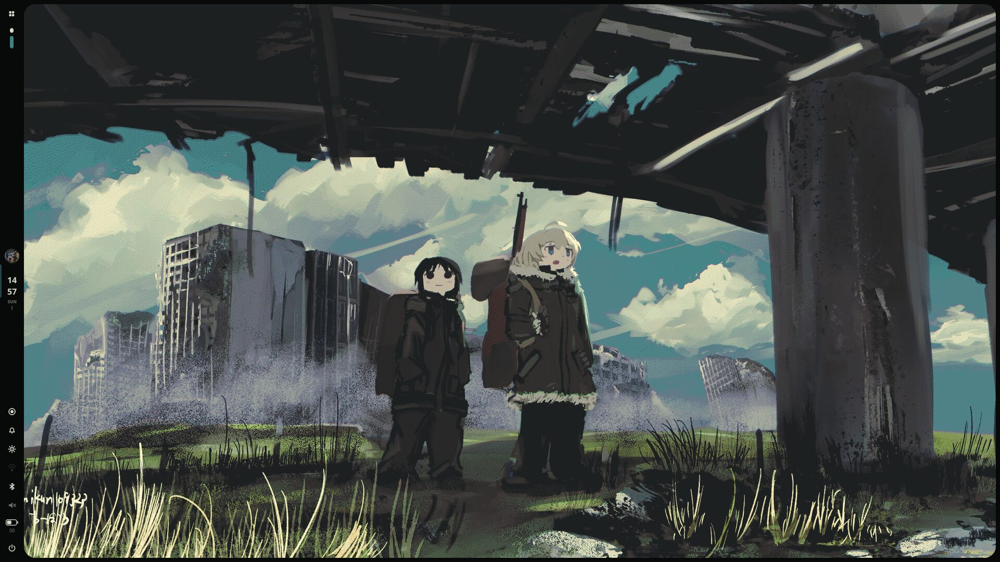
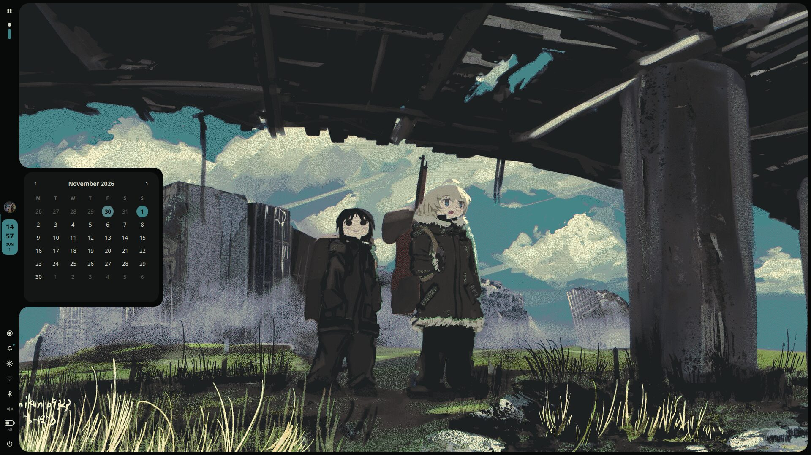
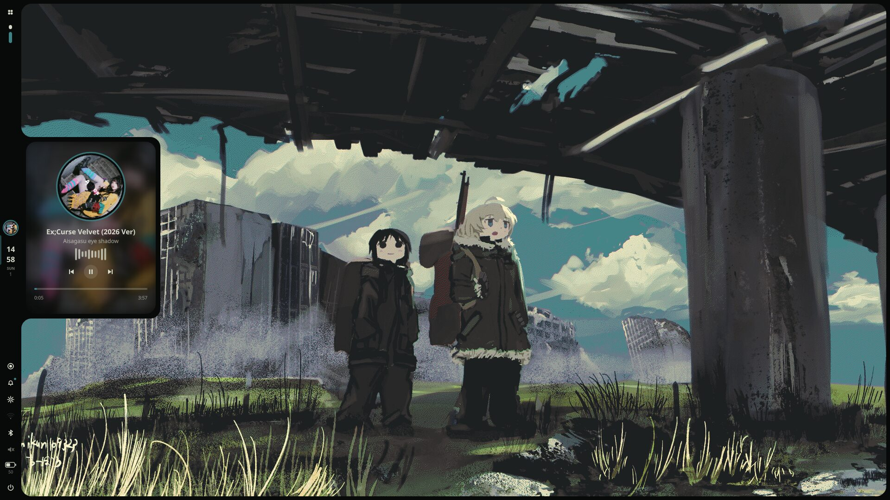
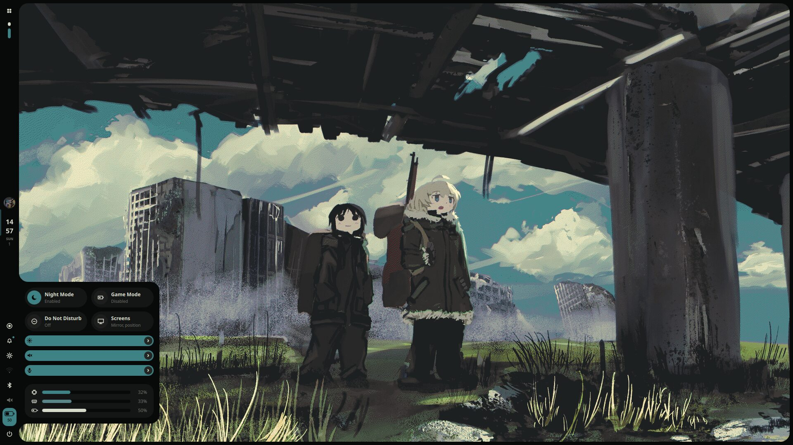
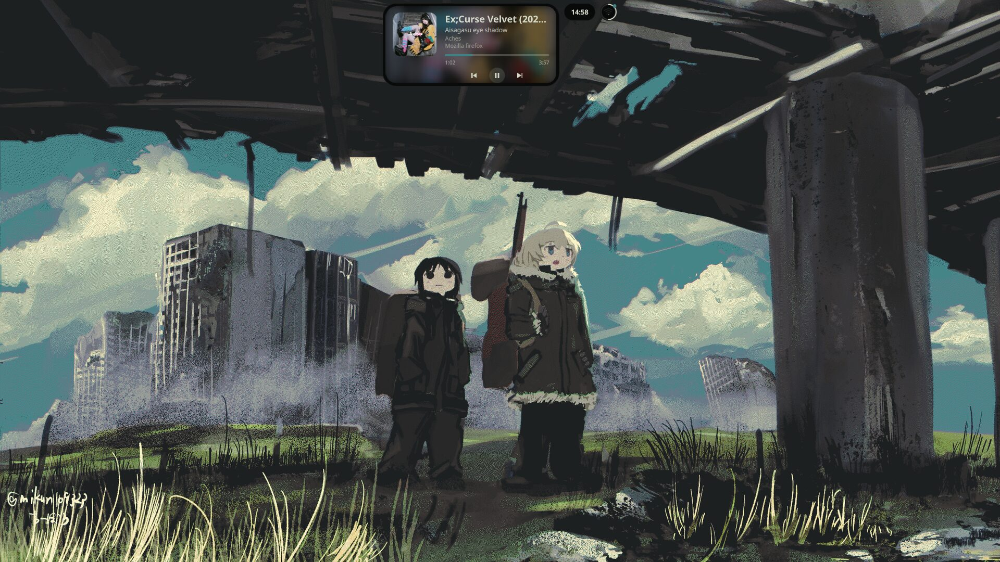
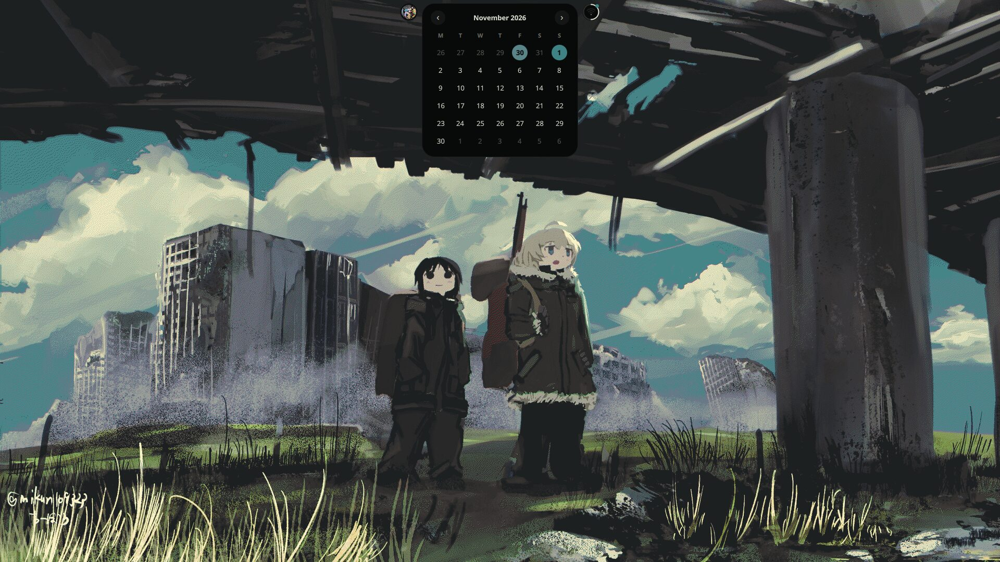
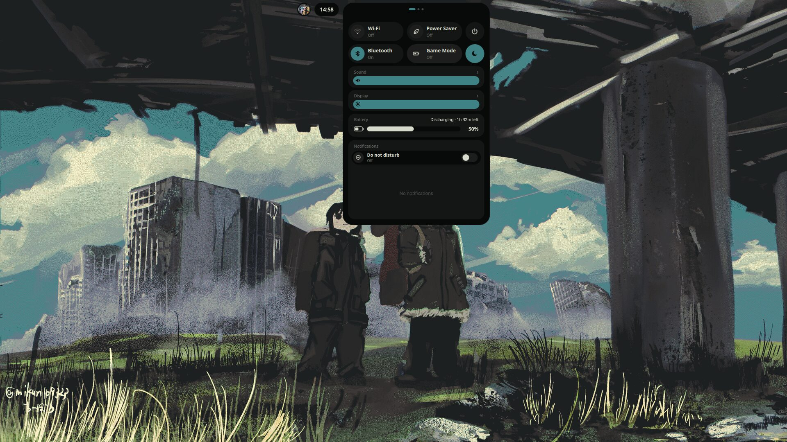
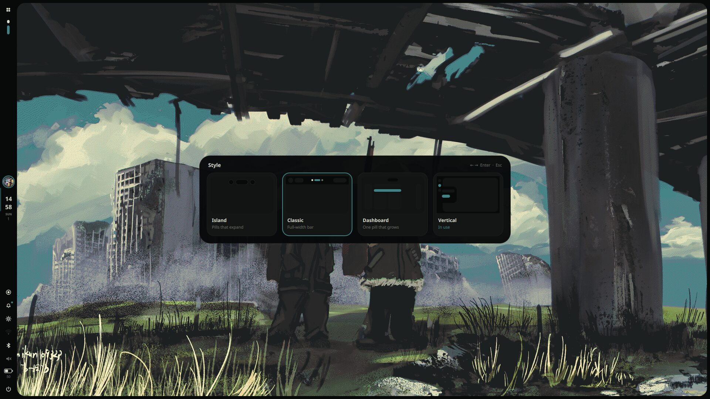
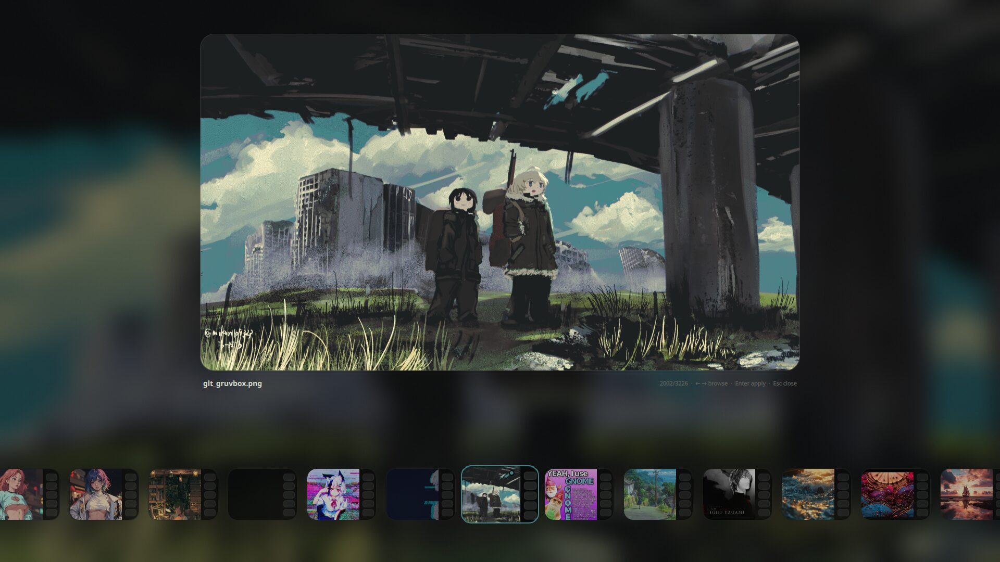

# quickshell-dots

[🇬🇧 English](README.md) · 🇮🇹 Italiano

Una shell desktop completa fatta con [Quickshell](https://quickshell.org), per **niri** e **Hyprland**.
Un'unica installazione, le stesse scorciatoie e gli stessi quattro stili su tutti e due i compositor.

> ## ⚠️ Leggi qui prima di aprire una issue
>
> Questo **non è un progetto per tutti**. L'ho fatto perché mi andava, e funziona sul **mio** portatile.
> Non nasce per essere un prodotto: niente roadmap, niente supporto, niente promesse.
>
> 🤝 E non l'ho fatto nemmeno da solo: è un lavoro **a 4 mani con Claude** (la versione *free*, sì, davvero). Io decido cosa voglio, Claude scrive il codice, io lo rompo, Claude lo ripara. Ripetere.
>
> - Su casa tua non funziona? Complimenti, hai trovato una nuova funzione. **Non è un problema mio** 🫡
> - Pull request e idee sono benvenute, ma posso rispondere tra tre settimane o mai.
> - È tutto MIT: fai un fork, piegalo, rendilo tuo. È proprio questo il punto.
> - Provato su niri e Hyprland su Arch. Tutto il resto: il tester ora sei tu.

## Screenshot

### Vertical

<p>




</p>

### Dashboard

<p>


</p>

### Island

<p>



</p>

### Selettori di stile e wallpaper

<p>


</p>

## Cosa trovi

- **4 stili da cambiare al volo** (`Alt+S` apre il selettore, oppure `Mod+Alt+1..4`):
  **Island** (pillole fluttuanti che si espandono), **Classic** (barra a tutta larghezza), **Dashboard** (una pillola che diventa pagine) e **Vertical** (barra laterale con pannelli attaccati).
- Launcher con preferiti, menu power, schermata di blocco, centro notifiche con Non disturbare, calendario con promemoria, timer e cronometro.
- Impostazioni rapide: Wi-Fi, Bluetooth, audio, schermo, monitor (posizione, scala, rotazione), layout tastiera, Game Mode ed Eco Mode.
- Selettore wallpaper; i colori di tutta la shell (e di Firefox, con Pywalfox) seguono lo sfondo tramite pywal.
- Screenshot e registrazione schermo (con richiesta del nome e scelta dell'audio), player multimediale con spettro audio in tempo reale.
- OSD volume / luminosità, cronologia appunti.

## Installazione

```sh
git clone https://github.com/mohamedmousamm777-eng/quickshell-dots
cd quickshell-dots
sh install.sh
```

L'installer ti dice cosa sta facendo a ogni passo. Fa questo:

1. riconosce niri e/o Hyprland (oppure usa `--niri`, `--hyprland`, `--all`);
2. controlla i programmi necessari e ti propone di installare quelli mancanti (Arch: `pacman`, più `yay`/`paru` per i pacchetti AUR);
3. salva un backup di tutto ciò che sostituisce in `~/.config/quickshell-backup-DATA`;
4. cerca altre shell (noctalia, caelestia, DankMaterialShell, illogical-impulse...) e, se sei d'accordo, le ferma e sposta le loro impostazioni nel backup (con `--purge` disinstalla anche i loro pacchetti);
5. installa la shell e la configurazione di niri / Hyprland;
6. prepara la cartella dei wallpaper e avvia la shell.

Opzioni: `--yes` (non chiede niente), `--no-deps` (salta il controllo dei programmi), `--purge`.

**La configurazione del tuo compositor viene sostituita** (`~/.config/niri/config.kdl`, `~/.config/hypr/hyprland.lua`): l'installer chiede prima e tiene un backup. Dopo, modifica a gusto tuo le app (kitty, firefox, nautilus) e i layout tastiera (`it,us,gb,fr,de`).

### Servono

`quickshell`, `awww` (o `swww`), `pywal`, `jq`, `grim`, `slurp`, `wf-recorder`, `ffmpeg`, `wireplumber`, `playerctl`, `brightnessctl`, `cava`, `cliphist`, `wl-mirror`, `imagemagick`, `libnotify`, `inotify-tools`, `xdg-user-dirs`, e in più, se vuoi, `pywalfox`.

### Wallpaper

Metti le immagini in `<Immagini>/Wallpapers` (ad esempio `~/Immagini/Wallpapers` o `~/Pictures/Wallpapers`, la cartella la crea l'installer), poi premi `Alt+W`.

## Scorciatoie

`Mod` = Super. Uguali su niri e Hyprland.

| Tasti | Azione |
|---|---|
| `Mod+R` / `Alt+R` | launcher |
| `Mod+M` / `Alt+P` | menu power |
| `Alt+W` | selettore wallpaper |
| `Alt+L` | blocca lo schermo |
| `Alt+I` | risorse di sistema |
| `Alt+Tab` | mostra i workspace |
| `Alt+G` | Game Mode |
| `Alt+E` | Eco Mode |
| `Alt+D` | Non disturbare |
| `Mod+Space` | layout tastiera successivo |
| `Alt+S` | selettore degli stili |
| `Mod+Alt+1..4` | Island / Classic / Dashboard / Vertical |
| `Print` | menu screenshot e registrazione |
| `Mod+H` / `Mod+Shift+H` / `Mod+Ctrl+H` | screenshot: schermo / area / finestra |
| `Mod+Alt+H` / `Mod+Alt+Shift+H` | registra schermo / area (premi ancora per fermare) |
| `Mod+Alt+P` | pausa registrazione |
| `Mod+Return` `F` `E` | kitty, firefox, nautilus |
| `Mod+Q` `V` | chiudi, fluttuante |
| `Mod+Ctrl+F` / `Mod+Shift+F` | schermo intero / massimizza |
| `Mod+C` `Mod+-` `Mod+W` | centra, più stretta, più larga |
| `Mod+frecce` / `Mod+Shift+frecce` | focus / sposta |
| `Mod+1..0` / `Mod+Shift+1..0` | workspace / sposta la finestra lì |
| `Mod+Shift+E` | esci dal compositor |

Solo niri: `Mod+Tab` overview, `Mod+J` larghezze predefinite, `Mod+,` `Mod+.` colonne.
Solo Hyprland: `Mod+Tab` fissa i workspace, `Mod+J` cambia divisione, `Mod+P` pseudo, `Mod+S` scratchpad.

Tutto è anche un comando: `qs ipc call <target> <funzione>` (per esempio `qs ipc call style set side`).

## Com'è fatto il repository

```
quickshell/   la shell  ->  ~/.config/quickshell
niri/         config.kdl, quickshell.kdl (+ file gestiti dalla shell)
hypr/         hyprland.lua, quickshell-binds.lua (+ file gestito dalla shell)
install.sh
```

`quickshell-outputs.*` e `quickshell-tweaks.kdl` li scrive la shell da sola (pagina Monitors, Game/Eco Mode): non cancellarli.

## Ripristino

Tutto ciò che l'installer ha sostituito è in `~/.config/quickshell-backup-DATA`.

## Licenza

MIT
