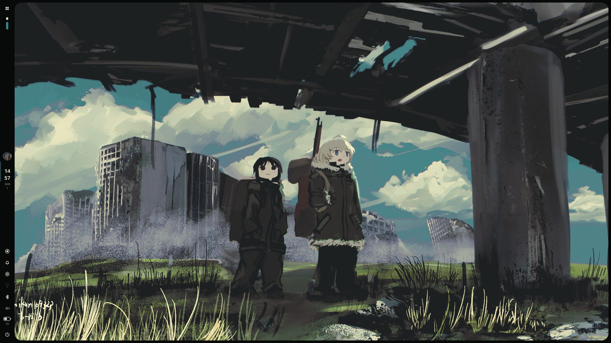
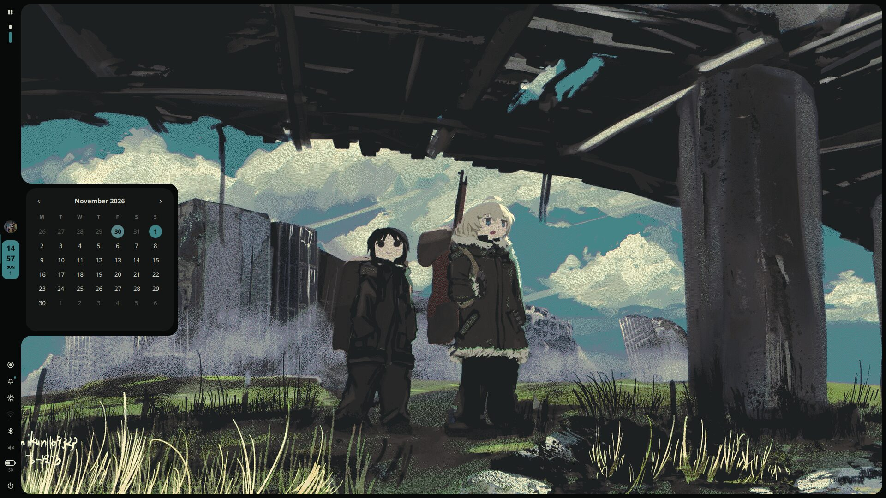
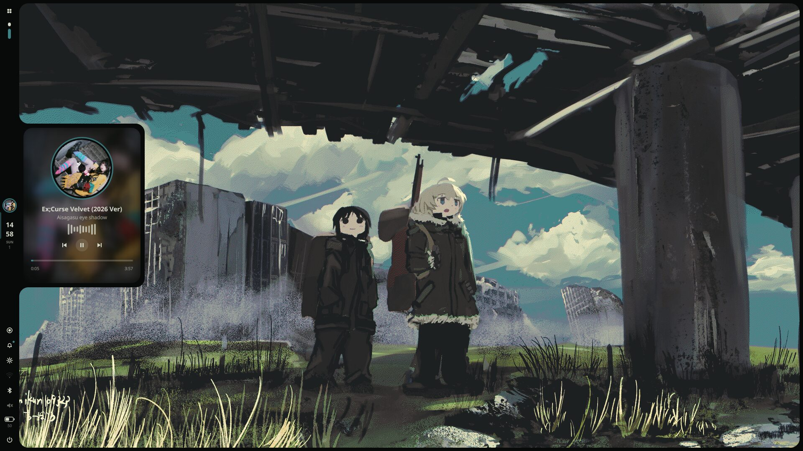
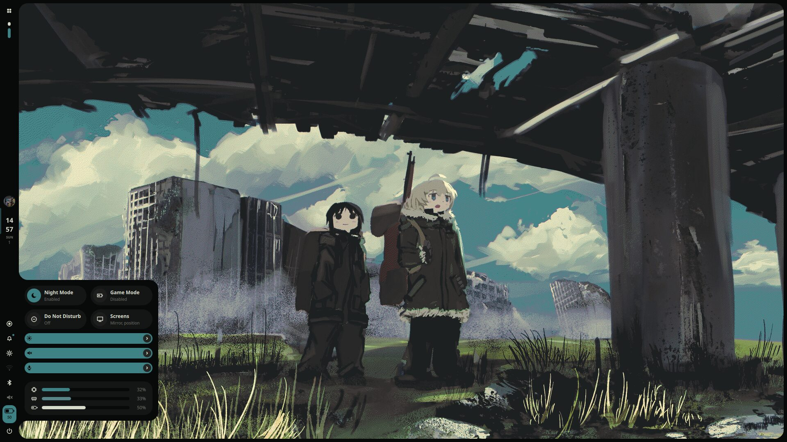
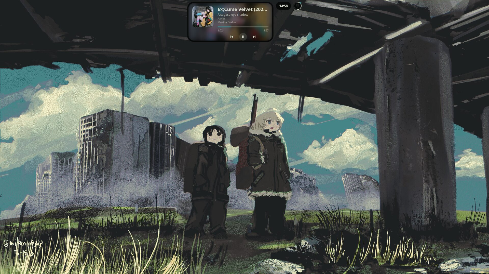
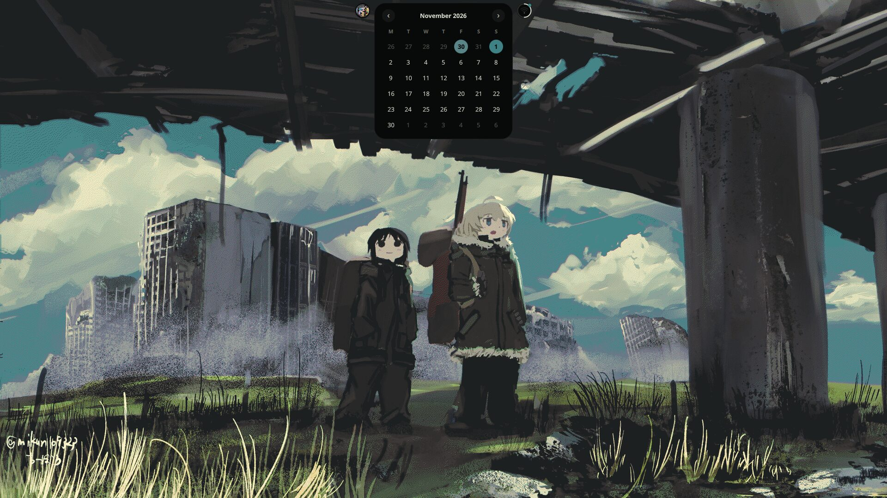
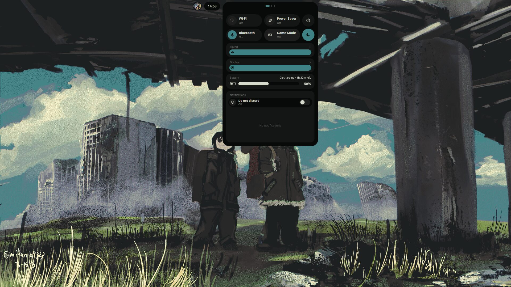
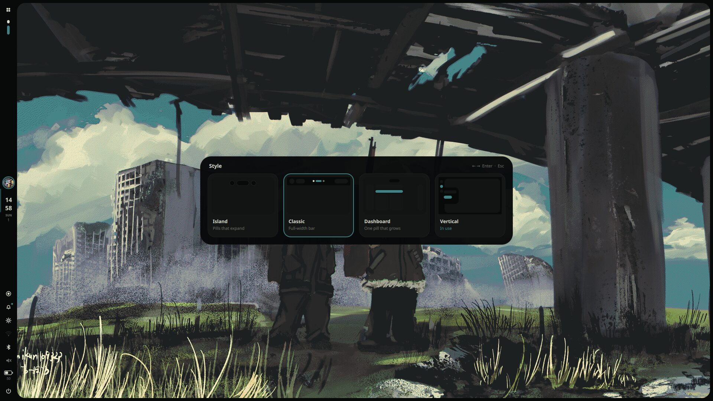
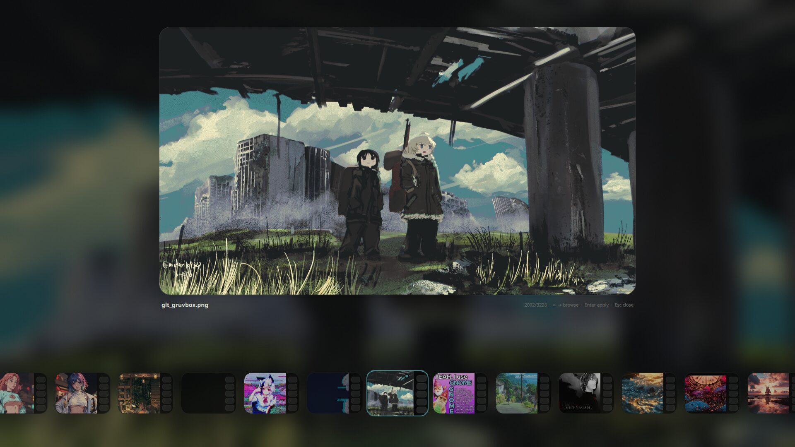

# quickshell-dots

🇬🇧 English · [🇮🇹 Italiano](README.it.md)

A complete desktop shell built with [Quickshell](https://quickshell.org), for **niri** and **Hyprland**.
One install, the same shortcuts and the same four styles on both compositors.

> ## ⚠️ Read this before opening an issue
>
> This is **not a project for everyone**. I made it because I felt like it, and it works on **my** laptop.
> It was not born to be a product: no roadmap, no support, no promises.
>
> 🤝 It was also **not made by me alone**: it is a 4-hands job with **Claude** (the *free* version, yes, really). I decide what I want, Claude writes the code, I break it, Claude fixes it. Repeat.
>
> - It breaks on your machine? Congratulations, you found a new feature. **Not my problem** 🫡
> - Pull requests and ideas are welcome, but I may answer in three weeks or never.
> - Everything is MIT: fork it, bend it, make it yours. That is the whole point.
> - It was tested on niri and Hyprland on Arch. Anything else: you are the tester now.

## Screenshots

### Vertical

<p>




</p>

### Dashboard

<p>


</p>

### Island

<p>



</p>

### Style and wallpaper pickers

<p>


</p>

## What you get

- **4 styles you can switch live** (`Alt+S` opens the picker, or `Mod+Alt+1..4`):
  **Island** (floating pills that expand), **Classic** (full-width bar), **Dashboard** (one pill that grows into pages) and **Vertical** (a side bar with panels attached to it).
- Launcher with favorites, power menu, lock screen, notification center with Do Not Disturb, calendar with reminders, timer and stopwatch.
- Quick settings: Wi-Fi, Bluetooth, sound, display, monitors (position, scale, rotation), keyboard layouts, Game Mode and Eco Mode.
- Wallpaper picker; the colors of the whole shell (and Firefox, with Pywalfox) follow the wallpaper through pywal.
- Screenshots and screen recording (with a name prompt and audio choice), media player with a live audio spectrum.
- Volume / brightness OSD, clipboard history.

## Install

```sh
git clone https://github.com/mohamedmousamm777-eng/quickshell-dots
cd quickshell-dots
sh install.sh
```

The installer tells you what it is doing at every step. It:

1. detects niri and/or Hyprland (or use `--niri`, `--hyprland`, `--all`);
2. checks the programs the shell needs and offers to install the missing ones (Arch: `pacman`, plus `yay`/`paru` for AUR packages);
3. saves a backup of everything it replaces in `~/.config/quickshell-backup-DATE`;
4. finds other shells (noctalia, caelestia, DankMaterialShell, illogical-impulse...) and, if you agree, stops them and moves their settings to the backup (`--purge` also uninstalls their packages);
5. installs the shell and the niri / Hyprland configuration;
6. prepares the wallpapers folder and starts the shell.

Options: `--yes` (ask nothing), `--no-deps` (skip the programs check), `--purge`.

**Your compositor config is replaced** (`~/.config/niri/config.kdl`, `~/.config/hypr/hyprland.lua`): the installer asks first and keeps a backup. Edit the apps (kitty, firefox, nautilus) and the keyboard layouts (`it,us,gb,fr,de`) to your taste afterwards.

### Needs

`quickshell`, `awww` (or `swww`), `pywal`, `jq`, `grim`, `slurp`, `wf-recorder`, `ffmpeg`, `wireplumber`, `playerctl`, `brightnessctl`, `cava`, `cliphist`, `wl-mirror`, `imagemagick`, `libnotify`, `inotify-tools`, `xdg-user-dirs`, and optionally `pywalfox`.

### Wallpapers

Put your images in `<Pictures>/Wallpapers` (for example `~/Pictures/Wallpapers` or `~/Immagini/Wallpapers`, the installer creates it), then press `Alt+W`.

## Shortcuts

`Mod` = Super. Identical on niri and Hyprland.

| Keys | Action |
|---|---|
| `Mod+R` / `Alt+R` | launcher |
| `Mod+M` / `Alt+P` | power menu |
| `Alt+W` | wallpaper picker |
| `Alt+L` | lock screen |
| `Alt+I` | system resources |
| `Alt+Tab` | show workspaces |
| `Alt+G` | Game Mode |
| `Alt+E` | Eco Mode |
| `Alt+D` | Do Not Disturb |
| `Mod+Space` | next keyboard layout |
| `Alt+S` | style picker |
| `Mod+Alt+1..4` | Island / Classic / Dashboard / Vertical |
| `Print` | screenshot and recording menu |
| `Mod+H` / `Mod+Shift+H` / `Mod+Ctrl+H` | screenshot: screen / area / window |
| `Mod+Alt+H` / `Mod+Alt+Shift+H` | record screen / area (press again to stop) |
| `Mod+Alt+P` | pause recording |
| `Mod+Return` `F` `E` | kitty, firefox, nautilus |
| `Mod+Q` `V` | close, float |
| `Mod+Ctrl+F` / `Mod+Shift+F` | fullscreen / maximize |
| `Mod+C` `Mod+-` `Mod+W` | center, narrower, wider |
| `Mod+arrows` / `Mod+Shift+arrows` | focus / move |
| `Mod+1..0` / `Mod+Shift+1..0` | workspace / move window there |
| `Mod+Shift+E` | quit the compositor |

Only on niri: `Mod+Tab` overview, `Mod+J` width presets, `Mod+,` `Mod+.` columns.
Only on Hyprland: `Mod+Tab` pin workspaces, `Mod+J` toggle split, `Mod+P` pseudo, `Mod+S` scratchpad.

Everything is also a command: `qs ipc call <target> <function>` (for example `qs ipc call style set side`).

## Layout of the repository

```
quickshell/   the shell  ->  ~/.config/quickshell
niri/         config.kdl, quickshell.kdl (+ files the shell manages)
hypr/         hyprland.lua, quickshell-binds.lua (+ file the shell manages)
install.sh
```

`quickshell-outputs.*` and `quickshell-tweaks.kdl` are written by the shell itself (Monitors page, Game/Eco Mode): don't delete them.

## Restore

Everything the installer replaced is in `~/.config/quickshell-backup-DATE`.

## License

MIT
